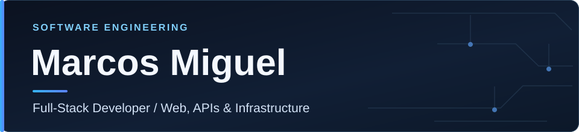

<!-- Perfil profissional | Marcos Miguel -->

  

  <strong>Construindo aplicações web, integrações e produtos digitais com foco em qualidade e manutenção.</strong>

  <a href="#sobre">Sobre</a> ·
  <a href="#tecnologias">Tecnologias</a> ·
  <a href="#projetos">Projetos</a>

---

## Sobre

Sou **desenvolvedor Full-Stack** com atuação em sistemas web, produtos digitais e infraestrutura. Trabalho com planejamento técnico, implementação de interfaces e APIs, modelagem de dados, integrações e implantação.

**Principais frentes de trabalho:**

- **Aplicações sob medida:** sistemas de gestão, dashboards e painéis administrativos.
- **APIs e automações:** autenticação, integrações, webhooks e processamento de eventos.
- **Qualidade e operação:** testes, desempenho, controle de versões e implantação.
- **Desktop e FiveM:** conhecimentos em Electron e Lua, incluindo scripts para ajustes de handling de veículos e painéis.

## Tecnologias

  

**Frontend:** React, Next.js, TypeScript e Tailwind CSS.  
**Backend e dados:** Node.js, APIs REST, Python, PostgreSQL, SQLite e Cloudflare D1.  
**Infraestrutura:** Linux, Git, Docker, Cloudflare Workers, Vercel e CI/CD.  
**Desktop e jogos:** Electron e Lua (scripts e ajustes para FiveM).

## Projetos

**[São Paulo Capital RP](https://www.saopaulocapitalrp.com.br/)**  
Site público de uma comunidade de roleplay, com páginas de apresentação e informações para jogadores.

**Stream Monitor**  
Sistema de monitoramento de transmissões ao vivo, com integrações entre plataformas, automações e dashboards operacionais. *Em evolução; código privado.*

---

  <strong>Aberto a oportunidades de desenvolvimento freelance e colaboração técnica.</strong>
   
  Web applications · APIs · Automation · Infrastructure

